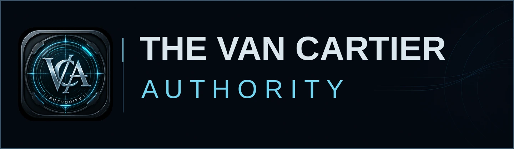
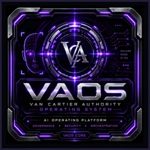
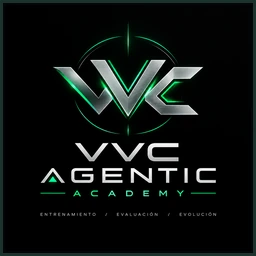
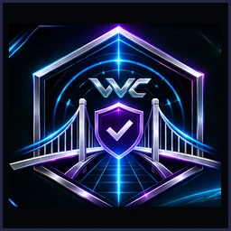

**Gobernanza, formación y auditoría de sistemas multiagente.**

## Proyectos insignia

### VAOS

Arquitectura de gobernanza y orquestación que define quién autoriza una acción, con qué permisos y qué evidencia debe quedar. El prototipo de supervisión evalúa solicitudes frente a un contrato de operación y conserva en memoria las decisiones con un hash SHA-256 verificable. 

### VVC Agentic Academy

Plataforma de formación y experimentación con agentes de IA. Su API permite registrar agentes y definir tareas con instrucciones y criterios de evaluación. La evaluación de las ejecuciones y el seguimiento de resultados y evidencias forman parte del diseño de la plataforma. 

### VVC Agent Audit Bridge

Infraestructura para auditorías técnicas independientes. Vincula los informes a los commits revisados y a la corrida de GitHub Actions correspondiente. Valida los informes y su manifiesto con hashes SHA-256. El flujo de verificación se ha probado en CI con casos sintéticos. 

## Misión

Desarrollar sistemas multiagente con responsabilidades explícitas, tareas evaluables y evidencia que permita revisar sus decisiones.

## Visión

Integrar la gobernanza, la evaluación práctica y la auditoría independiente en un ciclo de trabajo reproducible. Documentar y publicar implementaciones de referencia y ejemplos verificables.

## Valores

- **Responsabilidad.** Delimitamos quién puede decidir, autorizar y ejecutar.
- **Mínimo privilegio.** Cada agente recibe los permisos necesarios para su tarea.
- **Trazabilidad.** Registramos las decisiones y la evidencia asociada.
- **Rigor técnico.** Documentamos el alcance de cada comprobación y las condiciones para reproducirla.

## Tecnologías verificadas

- **VAOS.** Python y Flask. Empaquetado con Docker para Google Cloud Run.
- **VVC Agentic Academy.** TypeScript, Cloudflare Workers y Cloudflare D1.
- **VVC Agent Audit Bridge.** Python, Git, GitHub Actions y JSON Schema 2020-12.
